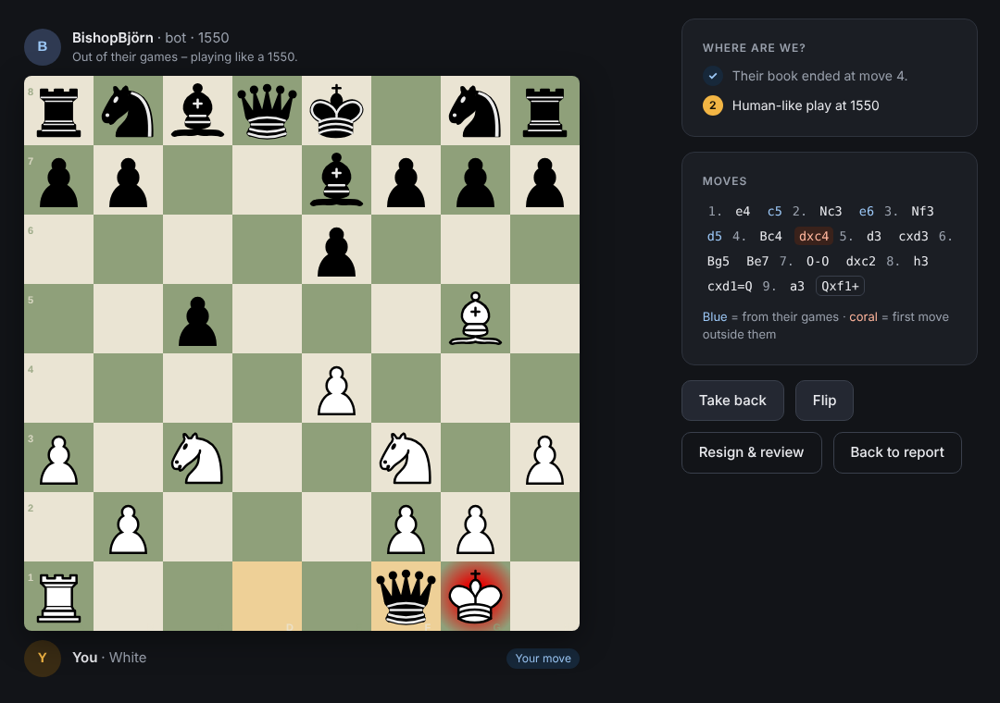
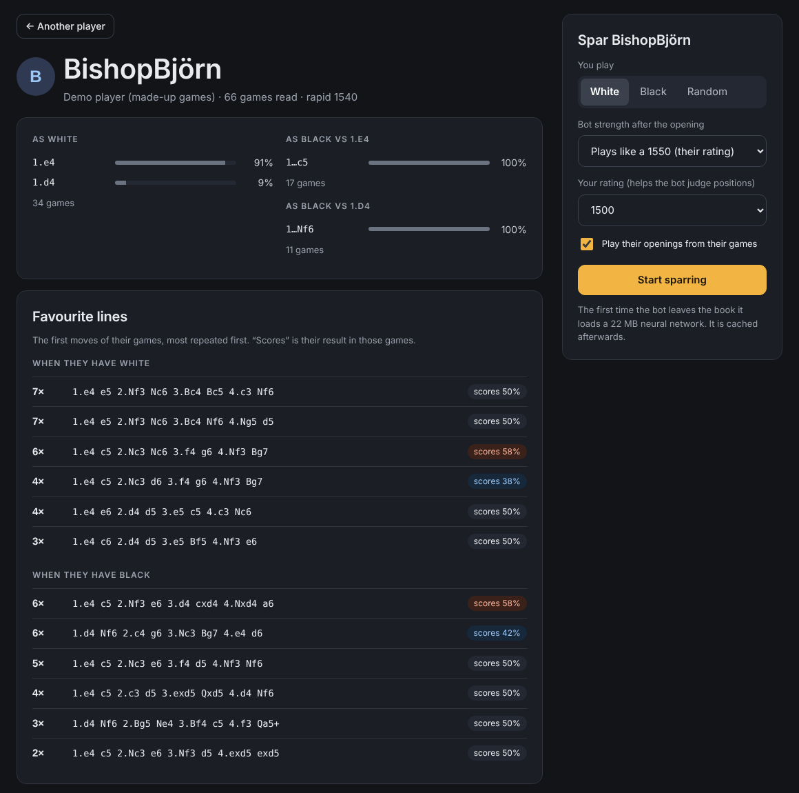
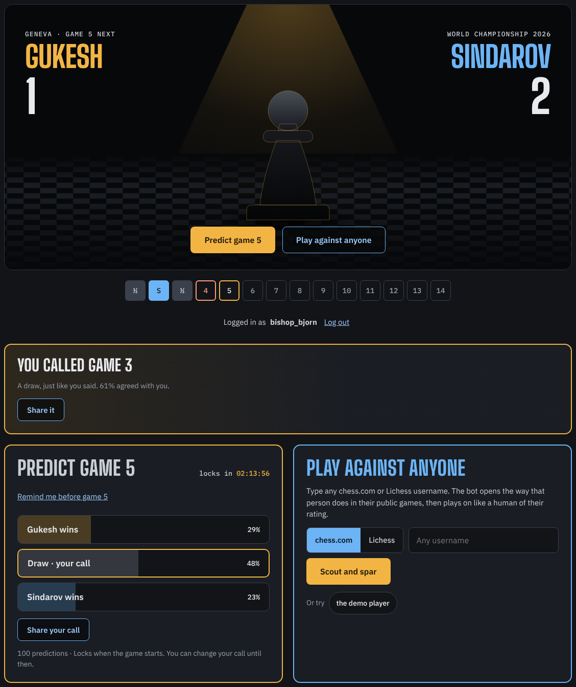
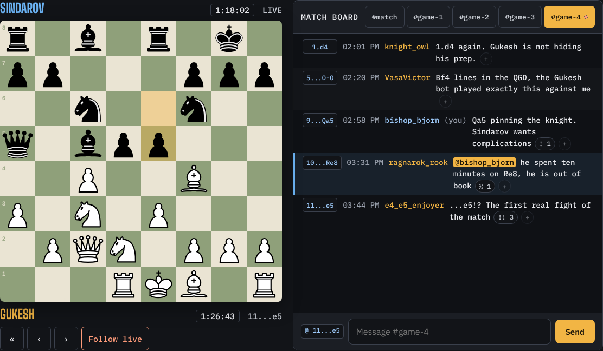

# Shadowbook

[](https://github.com/godvig/shadowbook/actions/workflows/ci.yml)
[](LICENSE)

**Chess opponent prep: play the person, not the engine.** Type in a chess.com or Lichess username and Shadowbook builds a sparring
partner that opens exactly like that player – the same moves, as often as they really play them – and then plays on
like a human of their rating.

Engines don't prepare you for Saturday's club game. Your opponent's 1.e4 c5 2.Nc3 e6 does. Shadowbook lets you
rehearse the games you are actually going to get, find out where your preparation runs out, and turn that into lessons.



## Live demo

**[shadowbook.godvig.com](https://shadowbook.godvig.com/)** – no account needed. Scout any public
player, or spar the built-in demo player *BishopBjörn* (a made-up 1540 with a weakness for the Fried Liver).

## Quick start

```bash
git clone https://github.com/godvig/shadowbook.git
cd shadowbook
npm install
npm run dev        # http://localhost:5173/
```

Requires Node 20+. `npm run build` produces a static site in `dist/` that can be hosted anywhere.

## Features

- **Scouting report** – what they play as White and Black, their most repeated lines and how they score in them.
  Filter by time control.
- **Their openings, their frequencies** – the bot picks each move with the same probability the player chose it in
  their games, and tells you so ("played c5 in 17 of 17 games here").
- **Human-like after the book** – when the player's games run out, [Maia3](https://github.com/CSSLab/maia3), a neural
  network trained to predict the moves of humans at a given rating, takes over at their strength.
- **Debrief** – where their book ended, whether you surprised them with a move they had never faced, the moves that
  cost you the most (with what a strong human would have played), PGN export and one-click Lichess analysis.
- **Rematch from the critical moment** – replay from the move where their preparation ended.
- **Private by design** – everything runs in your browser. Games are cached locally in IndexedDB; nothing is sent to
  any server except the public chess.com/Lichess APIs.
- **Works without an account** – chess.com and Lichess games are public, a PGN upload works for anything else.
- **Spar like Gukesh or Sindarov** – two preset bots for the 2026 World Championship. Each opens with the moves the
  player chose in their classical over-the-board games of 2024–2026, as often as they chose them, then hands over to
  Maia3 at 2600: it opens like a world-class player, then plays like a strong human – not at world-champion strength.
  From any game of the match you can "Spar this opening" from the move where it left the bot's book.



### Shadowbook Live – the World Championship match hub

A second tab built for Gukesh vs Sindarov (Geneva, 2026): a place to follow the match, call every game and talk about it.
Live at [shadowbook.godvig.com/world-chess-championship-2026](https://shadowbook.godvig.com/world-chess-championship-2026/)
(and [in Swedish](https://shadowbook.godvig.com/sv/schack-vm-2026/)), each a static, crawlable page with event structured data that the app mounts on.



- **Predict every game** – Gukesh, draw or Sindarov. Calls lock when the game starts; a correct call scores a point,
  two if fewer than a third of voters saw it coming. A leaderboard ranks the best predictors.
- **A board that follows the game** – moves, clocks and results sync from the official Lichess broadcast every 30 seconds.
- **Chat pinned to moves** – every message is tagged with the move it was written at; click the tag to see the board at that
  moment. React with annotation glyphs (`!!` `!` `?` `??` `½`) and `@mention` other players.
- **Share cards** – a 1080×1080 image of your call, or "Called it" after the game, plus link previews for the site.
- **Match stats** – results, how often the crowd was right, openings and first moves, and your own record.
- **Calendar reminders** – an `.ics` file with an alarm 30 minutes before each game locks.
- **Spar the opening** – jump from the match straight into a sparring game against anyone.



*Screenshots use sample data.* Anyone can follow along; predicting and chatting use "Log in with Lichess"
(OAuth PKCE – no password ever touches the site).

## Architecture

```
src/
  lib/
    sources.ts   chess.com Published-Data API, Lichess export API, PGN files  →  Game[]
    book.ts      Game[] → per-position move statistics for one player (transposition-aware)
    bot.ts       book move (weighted by frequency) → otherwise Maia3 sampled at the player's rating
    review.ts    debrief: Maia3's value head scores each of your moves at your rating
    storage.ts   IndexedDB cache of scouted players
  live/          the match hub: Lichess login (PKCE), Supabase client, match logic, chat, stats, share cards, calendar
  views/         Home → Report → Game → Debrief, and Match
  components/    Board (Lichess' Chessground)
supabase/
  migrations/    Postgres schema with row level security, realtime, a pg_cron job for the broadcast sync
  functions/     match-api: the only write path – verifies Lichess tokens, saves votes, posts and reactions, syncs the broadcast
```

- **Moves and rules:** [chess.js](https://github.com/jhlywa/chess.js)
- **Board:** [Chessground](https://github.com/lichess-org/chessground), the board used on lichess.org
- **Human-like play:** [maia3-js](https://www.npmjs.com/package/maia3-js) running the 5M-parameter Maia3 network with
  [ONNX Runtime Web](https://onnxruntime.ai/) (wasm). The 22 MB network is served from this site and cached by the browser.
- **Stack:** React 19, TypeScript, Vite, deployed to GitHub Pages by GitHub Actions.
- **Match hub backend:** [Supabase](https://supabase.com/) – Postgres with row level security (the browser can only read),
  realtime subscriptions, one Edge Function as the only write path, and a pg_cron job that pulls the
  [Lichess broadcast](https://lichess.org/api#tag/broadcasts). Setup in [`supabase/README.md`](supabase/README.md).
- **Preset games:** the moves of published classical games from the official broadcasts relayed on
  [Lichess](https://lichess.org/broadcast), read with the [Broadcast API](https://lichess.org/api#tag/broadcasts).
  `npm run presets` rebuilds `public/presets/*.json` from the events in
  [`scripts/presets.config.json`](scripts/presets.config.json); each file lists its source events. Run by hand, not in CI.

## Tests

```bash
npm test           # Vitest: PGN parsing, book building, bot move selection, presets, match logic,
                   # broadcast sync, chat, stats, share cards, calendar files
npm run typecheck
npm run lint
```

CI runs all three on every push.

## Roadmap

- [x] Spar any chess.com / Lichess player, scouting report, debrief
- [x] World Championship match hub: predictions, live board, chat pinned to moves, share cards
- [ ] Your own repertoire with spaced-repetition review (FSRS) – positions, not lines
- [ ] "Where your book meets theirs": compare your repertoire with an opponent's games before the game
- [ ] Turn debrief findings into review cards automatically
- [ ] Clocks and premoves
- [ ] Stockfish analysis next to Maia in the debrief
- [x] Installable app (PWA) with shortcuts to Match and Spar
- [ ] Offline sparring with the cached Maia model

## License

[AGPL-3.0](LICENSE). Shadowbook builds on GPL-licensed Chessground and MIT-licensed Maia3, chess.js and ONNX Runtime.
Not affiliated with chess.com or Lichess.
